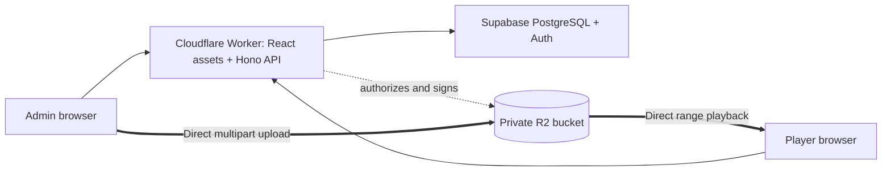
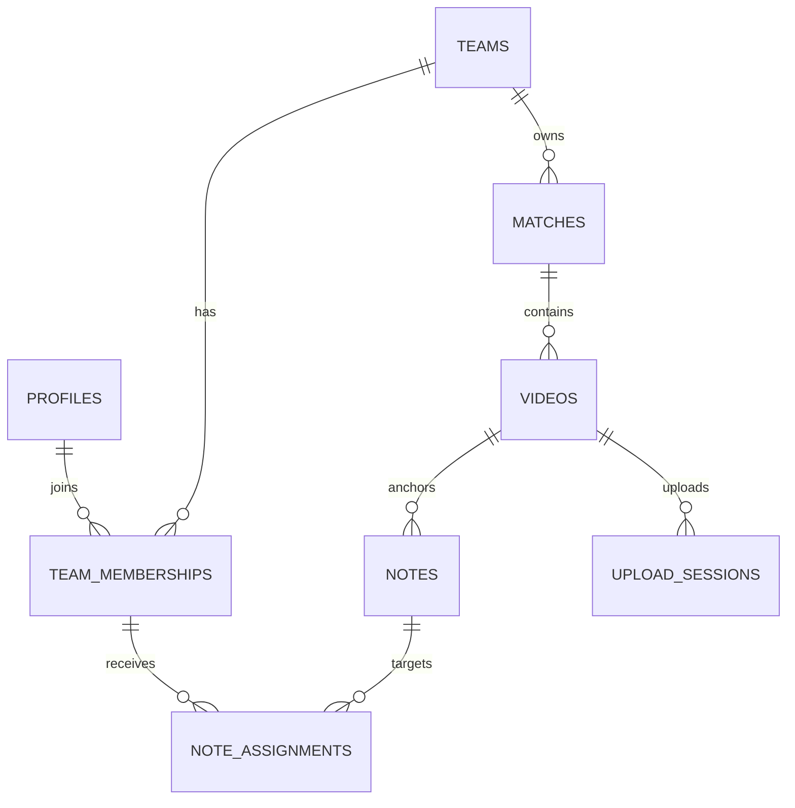

# Football Match Review — V1 implementation specification

**Status:** Approved functional scope; implementation-ready baseline  
**Audience:** AI coding agent / ChatGPT Work  
**Product name:** Football Match Review (working title)  
**Deployment target:** Cloudflare Workers, with separate DEV and PROD environments  
**Budget objective:** $0/month for initial personal use, within provider free allowances

## 1. Implementation brief

Build a responsive, private web application that lets football coaches/admins upload match recordings and import timestamped feedback assigned to players. Players can watch the full recordings or review only their assigned highlights. The application initially serves one team, but its data model and authorization must support more than one team without a rewrite.

The admin already has the recordings locally and analyses them outside the application. The admin is responsible for supplying footage in the supported V1 playback format, including any necessary conversion of GoPro recordings before upload. Do not build a local note-generation tool, a video annotation editor, or a transcoding pipeline. Testing will use compatible sample videos and manually written CSV files.

Implement a small, maintainable modular monolith. Prefer standard libraries and straightforward code over unnecessary abstractions. The owner is a Java/Spring developer; keep the TypeScript backend easy to understand, debug and potentially replace with Spring Boot in the future.

**Implementation instructions for the coding agent:**

- Deliver working source code, database migrations, tests, deployment configuration, example fixtures, and a setup/operations README. Do not deliver only a design or pseudocode.
- Do not require the owner to run the application locally to test it. Make cloud-first testing a supported workflow; local development remains optional.
- Build in independently verifiable increments. Prioritize the video-upload/playback proof of concept before investing in UI polish.
- Do not claim that an external account, deployment, or live test has been completed unless it actually has. If credentials or accounts are missing, finish the code/configuration and document the remaining owner actions.
- Treat the chosen defaults in §17 as implementation decisions, not permission to expand the product. Report any material deviations or unverified provider capabilities.
- Never require credentials to be pasted into a chat or committed to a repository.

## 2. Scope and priorities

| Mandatory V1 | Optional / deferred |
|---|---|
| Private login and account management | Lower-quality video variants (optional follow-up) |
| Team-scoped admins and players | Local notes-generation utility (separate future project) |
| Match management and multiple ordered recordings | Clip extraction / permanent highlight files |
| Original-quality, resumable direct uploads | HLS / adaptive bitrate / cloud transcoding |
| CSV import and manual correction of notes | Viewing history, progress tracking, analytics |
| Full video playback and timestamp seeking | Player replies/comments or notifications |
| Manual and automatic personal highlight playback | Academies, subscriptions, billing, self-service onboarding |
| Storage quota enforcement, manual/automatic archiving | Native iOS/Android apps |
| Restore original recordings without losing notes | Tactical drawing, live streaming, AI analysis |
| Separate cloud DEV/PROD and useful diagnostics | Enterprise infrastructure / microservices |

No public sign-up, no public videos, no requirement to view footage in the admin interface to create feedback. Admin playback may be available for verification, but must never be a prerequisite for publishing or editing notes.

## 3. Technology and deployment

| Layer | Selected technology |
|---|---|
| Frontend | React, TypeScript, Vite, Tailwind CSS |
| Web experience | Responsive mobile-first PWA; installable where supported |
| Backend | Hono on Cloudflare Workers, TypeScript |
| Application hosting | Cloudflare Workers with static assets; one origin/deployment per environment |
| Database | Supabase PostgreSQL, version-controlled SQL migrations |
| Authentication | Supabase Auth |
| Video storage | Private Cloudflare R2 buckets, S3-compatible API |
| Playback | Native HTML5 video, HTTP byte-range seeking |
| API | Standard REST/JSON, OpenAPI contract |
| Validation | Zod or equivalent runtime schemas |
| CSV | Established standards-compliant CSV parser |
| Testing | Vitest, Playwright, CI checks |
| Source control | Private GitHub repository |
| Deployment | GitHub + Cloudflare Workers Builds or CI-driven Wrangler deployment |
| Local video processing | Admin prepares compatible files externally (e.g. FFmpeg if necessary); not a V1 application dependency |



The browser transfers video directly to/from R2. Hono authorizes, reserves storage, creates upload sessions, signs requests, validates completion, and manages metadata. Do not proxy the original video through the Worker or store footage in Supabase. Do not cache private video bytes in the PWA service worker.

Keep REST contracts, SQL migrations and domain models independent of the hosting framework. Organize backend code into routes/controllers, services, repositories and infrastructure adapters, with Cloudflare/Supabase-specific code concentrated at integration boundaries. Use a small number of abstractions where genuinely useful. No Hono-specific client RPC as a mandatory frontend dependency.

Suggested repository layout (adjust if needed):

```text
football-review/
  frontend/                  React routes, pages, components, API client
  backend/                   Hono routes, services, repositories, auth, storage
  shared/                    Framework-neutral schemas/contracts
  supabase/migrations/        SQL migrations and seed/test fixtures
  tests/                     Integration and browser tests
  docs/                      OpenAPI, setup, operations, design decisions
  .github/workflows/          CI/deployment checks
  wrangler configuration     DEV/PROD bindings and schedules
  README.md
```

## 4. Accounts, teams and authorization

### Roles and membership

- Each authenticated person has one global identity/profile.
- A team has many memberships; a user may belong to several teams.
- Roles are scoped to a membership: `admin` or `player`. No global role on the profile is used for ordinary authorization.
- Team admins manage that team's players, matches, uploads, imports and notes. They can see all notes for their team and inspect footage if desired.
- Players can read published matches/recordings and only feedback assigned to them or marked team-wide. Players cannot access drafts, archived matches, other players' private feedback, or other teams' data.
- The owner provisions initial teams/admins through controlled setup/seed procedures. No public team creation, platform-admin UI, or academy hierarchy in V1. If a user has multiple active memberships, allow selection of the active team; for one membership, select it automatically.
- Store player-specific display identifiers (e.g. shirt number, if used) on the membership, not the global user. Preserve stable membership IDs independently of shirt changes.
- Removing a user from a team disables the membership rather than destroying historical note assignments. Deactivated accounts/memberships cannot gain new access.

### Account workflow

- Admin creates player accounts, communicates initial credentials privately, and can manage/reset team-local player access. Players can change their own password.
- Use Supabase Auth password sign-in. Proposed V1 default: admin supplies a unique email as the login identifier; accounts are created through the trusted admin API, with confirmation handled by that provisioning process. No mandatory SMTP, self-registration, magic-link or password-reset email workflow. If a username-only flow is desired later, specify it separately rather than inventing fake email identities.
- Team admins must not be able to reset a global identity used by other teams or take over a different team's existing account. For shared identities, initial linking and account recovery can be handled by the owner using a controlled operator procedure. Do not silently reset credentials on account collisions.
- No need for MFA, enterprise SSO or advanced account recovery for this personal-use V1.

### Security requirements

- Verify Supabase access tokens server-side using the supported SDK/JWKS or equivalent signature validation; check issuer, expiry, applicable audience and current user identity. Never trust a role/team ID supplied by the browser without authorization.
- Enforce membership, role, match visibility and note assignments on **every** applicable API, including list/detail, import, mutation, archive, restore, upload completion, and signed playback URL issuance.
- Use database constraints and team-consistent foreign keys or equivalent transactional checks to prevent cross-team links. Prevent direct client-side access to protected data: configure RLS and grants accordingly; if a server-only privileged DB client is used, Hono must enforce all authorization because privileged keys can bypass RLS. Keep privileged credentials exclusively server-side.
- R2 buckets remain private. Sign short-lived object-specific URLs only after authorization. Do not expose R2 credentials. A signed URL is a bearer capability; an already issued URL may remain usable until it expires or the object is deleted. Do not promise instantaneous revocation or DRM.
- Use HTTPS, safe session handling, input validation and safe text rendering. Do not log credentials, tokens, full signed URLs, or private note contents. Treat imported text as data, not executable HTML. Avoid storing authenticated API responses in shared caches.

## 5. Match management

Each match belongs to one team. Admins can create, list, edit, publish, archive, restore and permanently delete matches.

Minimum metadata: opponent, match date, status, team ID. Support competition, result and home/away venue as optional metadata. Record creation/update timestamps and relevant publication/expiry metadata.

| State | Player access | Admin access |
|---|---|---|
| Draft | No | Manage metadata, upload footage, import/edit notes |
| Published | Yes, team-scoped | Manage, inspect and archive |
| Archived | No | Retained metadata, notes, video identities; restore or delete |
| Permanently deleted | No | No; remove associated data and files after confirmed cleanup |

A transient archiving/deleting/restoring state may be used internally for safe recovery. Publishing requires at least one completed, valid recording; zero notes are allowed. All intended recordings must be available before publishing. Notes can be edited after publication. Draft and archived data must never leak via player APIs.

## 6. Video organization and uploads

- Each match may contain any reasonable number of named, ordered recordings (e.g. first half, second half). Each recording has a permanent database ID, stable import key, title, display order, duration, original file size/name, checksum and storage status.
- Every note belongs to exactly one recording and uses a start/end timestamp relative to that recording's timeline. A note must not span two files; use separate notes if needed. Reordering recordings must not affect note associations.
- Admin selects files and initiates uploads within the app; no routine Cloudflare dashboard interaction.
- Preserve the exact bytes and quality of the file supplied by the admin. For V1, support browser-compatible MP4 with H.264 (AVC), 8-bit 4:2:0 video and AAC audio (or no audio); use a broadly compatible encoding profile/level. MP4 alone does not guarantee compatibility. Native H.265/HEVC GoPro recordings and other formats are not required to work in V1. The admin prepares compatible files externally before upload, if needed. Do not implement format conversion, automatic transcoding, or a separate codec-detection pipeline. Perform practical browser metadata/playability checks before upload where feasible and report unsupported files or playback failures clearly. Test seeking and playback on the target browsers. Recommend fast-start MP4 (metadata at the beginning) for externally prepared files. Notes must refer to the timeline of the actual file uploaded, and that exact prepared file must be kept locally for checksum-based restoration.
- Support multi-gigabyte files, including files above the single-upload limit. Implement multipart uploads with progress, retry of failed parts, cancellation and resume (including a page reload/file re-selection where practical; verify re-selected file identity). Do not read an entire multi-GB file into RAM.
- Use presigned, short-lived S3-compatible multipart `UploadPart` requests scoped to a server-created upload session and object key; verify current R2 support for the exact signing flow. The backend initiates/completes/aborts the session, validates ownership, reconciles listed parts/ETags and verifies final object size. Do not assume a multipart ETag is a whole-file SHA-256.
- Configure R2 CORS narrowly for DEV/PROD app origins and necessary methods, request headers and exposed response headers (including ETag for multipart). Browser receives no storage access keys.
- Upload session state persists in the database; record intended size, expected digest, team, target recording, object key, provider upload ID, expiry and status. Use unique object keys for upload attempts, not user-supplied paths. Treat initiation/completion retries idempotently. Expire stale sessions and abort unfinished multipart uploads, with R2 lifecycle cleanup as a fallback.
- Before making an object available, verify it belongs to the expected session, has the expected size, and has usable media metadata. If verification fails, keep it inaccessible, report the failure and clean it up. Handle DB/R2 failures without losing existing records or leaking untracked objects.

### Optional quality variants

V1 needs only original-quality playback. Do not delay the release for 720p/480p variants. Keep logical recording identity separate from the physical storage key so variants can be added later without changing note references. Future variants must share the same timeline and count toward quota. Video conversion may be considered later either within the application or as part of the separate local notes-generation tool; neither option is in V1. No automatic or cloud transcoding in V1.

## 7. CSV import and note management

The local notes-generation tool does not exist and is not part of this project. Use manually generated CSV fixtures with compatible sample videos for development and testing.

### Proposed V1 CSV contract

This is a deliberately simple initial format chosen for testing and implementation; it can be revised independently of the future local tool.

```csv
Video,Start,End,Players,Note
H1,00:00:12,00:00:22,P006;P008,"Close the passing lane"
H1,00:00:30,00:00:45,P010,"Scan before receiving, then turn"
H2,00:00:05,00:00:15,ALL,"Good collective press"
```

- `Video`: stable, match-local import key shown in the admin interface (e.g. `H1`, `H2`); it is not a display-order index or mutable title.
- `Start`, `End`: recording-relative `HH:MM:SS` with optional milliseconds (`.mmm`); normalize to integer milliseconds. Validate `0 <= start < end <= duration` using an explicitly documented small tolerance only if necessary for browser media metadata.
- `Players`: semicolon-separated, stable team-local player codes (shown in roster management), or `ALL` alone for team-wide feedback. Resolve to membership IDs at import. Reject unknown, ambiguous, duplicate (or normalize duplicates consistently), inactive, or cross-team references. Never resolve by ambiguous names or mutable shirt numbers alone.
- `Note`: non-empty plain text, with a documented reasonable length cap. Support UTF-8, optional BOM, CRLF/LF, quoted fields and embedded commas/newlines using a real CSV parser.
- Treat `ALL` as a team-wide visibility flag, not a list of every player at import time. Only currently authorized team members can read it. Explicit assignments remain attached to the original membership.

### Import UX and behavior

1. Admin selects a match and a CSV file through the app.
2. Parse and validate all records; display preview, resolved recording/player references and row-specific errors. Provide a sample/template CSV and visible recording/player codes.
3. Admin confirms import. Repeat authoritative validation on the server. Commit all rows and their assignments atomically (or reject the entire import). Use a bounded file/row limit appropriate to a team and Worker CPU budget; report the limits in the UI and documentation.
4. Guard against repeated submission/network retry creating duplicate notes, e.g. an idempotency key scoped to the match/import. Do not silently overwrite existing notes. Default import behavior: append; replacement, if ever implemented, must be explicit and confirmed.
5. Admin can create, edit and delete individual notes and assignments manually, without streaming video. Players are read-only.

Do not store the CSV as the live source of truth. Store normalized notes/assignments in PostgreSQL. No need to retain original CSV files in cloud storage after successful import. The CSV parser can do preview work in the browser, but server-side authorization and data validation are mandatory.

## 8. Player experience

The application should be easy to use on a mobile browser and desktop. Prioritize readability, simple navigation, touch targets, responsive layouts, accessible labels, loading/empty/error states and mobile fullscreen playback.

### Navigation and pages

- Login and password change.
- Team selection only when necessary.
- Player match library: published matches only, date/opponent/result and available recordings; optionally display assigned note counts, **not** viewed/unviewed counts.
- Match detail: ordered recording selector, native playback controls, personal note list and timestamp markers.
- Admin area: roster, matches, upload/import, note management, archive/restore and storage usage.

### Playback modes

| Mode | Behavior |
|---|---|
| Full match | Play any recording and seek freely; show only the player's authorized note markers and notes. |
| Manual highlights | Selecting a note seeks to its start, plays the interval and pauses at the end (or remains paused until explicit play if the browser requires a user gesture). |
| Automatic highlights | Play the authorized notes in recording order and start-time order; jump to the next interval and switch recordings when needed; stop at the final highlight. |

- Allow switching modes and selecting another note at any point. Handle playback cancellation, seeking, browser autoplay restrictions, metadata loading, buffering, expired URLs and playback failures. Use appropriate event handling for end boundaries; avoid timers alone that drift during buffering.
- For overlapping highlights, keep individual notes visible; deterministic sequential playback is acceptable even if part of the footage repeats. No physical clip extraction or merging required.
- Load match/recording metadata and authorized notes without loading the entire video. A highlights list must be usable without initiating a video request. Use `preload="none"` or an equivalent strategy until selection; request signed URLs as needed.
- Seek using native video playback over HTTP Range (`206 Partial Content` where requested); test on actual browser/device targets. Browsers may fetch metadata, keyframe-aligned data, or extra buffering: do not claim that exactly the timestamp interval's bytes are fetched.
- Signed playback URLs must have sufficient validity for normal viewing, plus renewal/retry logic for expired URLs (preserve current recording/time/mode where possible). Do not provide permanent public URLs.
- No persistent viewing tracking, watched markers, engagement analytics, responses, comments or player editing. A transient current playback state is fine.

## 9. Storage, retention and restoration

### Quota and accounting

The free R2 Standard allowance is an account-wide monthly storage/operations allowance, not a hard provider-enforced storage ceiling or a lifetime upload limit. DEV and PROD share it. The aim is to rotate recordings, retaining notes separately; originals must remain backed up locally by the admin.

- Display used, reserved and available capacity; use actual byte units consistently (decimal GB for provider budget; label GiB explicitly if displayed).
- Set configurable, conservative per-environment limits whose sum remains below 10 GB, including safety margin. Suggested starting budgets: PROD 9.5 GB, DEV 0.25 GB, 0.25 GB remaining margin. These are policy defaults, not per-team free allowances; adjust explicitly if a recording cannot fit.
- Reserve declared upload bytes transactionally before issuing upload authority; account for concurrent uploads and incomplete multipart sessions. Verify actual part/object sizes; reject/clean up oversized or invalid uploads. Where provider signing supports it, bind the expected part length/checksum. A browser declaration by itself is not a hard provider-side byte limit.
- Include all stored objects and active reservations (no double counting of completed bytes already reserved). Reconcile counters with R2 object and multipart state periodically; fail closed if accounting is inconsistent rather than issuing unlimited upload sessions.
- Shared team usage may be displayed per team, but one overall environment cap must govern all teams. Do not promise each team a separate 10 GB free allocation.
- No automatic paid upgrade. Application controls reduce risk but cannot guarantee zero R2 charges (out-of-band uploads, orphaned parts, request volume and other account usage can affect billing). Document how the owner checks provider usage and configures available billing alerts.

### Manual and automatic archiving

- Admin can archive a match manually or select a retention period at publication (proposed choices: never, 7, 14 or 30 days; default manual-only unless owner changes it).
- Store an absolute expiry timestamp in UTC. Use a Cloudflare scheduled Worker/Cron Trigger for periodic processing; no separate background server. Make work bounded and retryable.
- Archiving immediately removes player access and deletes the R2 video objects; keep match, recording identities, original file metadata/checksum, notes and assignments. Mark cleanup failures visibly and retry. Do not release storage accounting until deletion has been confirmed.
- Archived matches are accessible only to admins. Players must not see archived notes or recordings in lists or direct API requests.
- Permanent match deletion is a separate, explicitly confirmed action that removes its footage and associated records, with recoverable cleanup handling. Do not confuse archive with hard deletion.

### Restore workflow

1. Admin opens an archived match and selects a specific existing recording to restore (e.g. recording ID 104 / H1).
2. Admin selects the original local file. Compare original size and SHA-256 digest; name may differ. Calculate digest incrementally in a browser worker or suitable streaming library to avoid buffering the whole file. Show hashing progress when possible.
3. If the file does not match, reject the restore. V1 does not support replacing a recording with a trimmed, re-encoded or otherwise different file, even if its duration appears identical.
4. Upload using the standard resumable flow, under a new physical object key or generation. Preserve the original database recording ID, import key, note references and order. Verify completed object metadata before committing availability.
5. Restore all required recordings; keep the match hidden from players until an admin explicitly republishes it. Set a new retention expiry on republication.

Client-computed hashes are a correctness check for trusted admin workflows, not proof against a malicious uploader. Verify provider-supported checksum semantics before relying on them; where full-object integrity cannot be independently checked within the free architecture, document that limitation instead of pretending it has been verified server-side. Do not hash GB-sized files inside a Worker.

## 10. Conceptual database model

Use PostgreSQL with version-controlled migrations, foreign keys, uniqueness/check constraints and indexes. UUIDs or equivalent immutable identifiers are suitable. The following is a baseline, not a prescribed final DDL.

| Table | Key fields / responsibility |
|---|---|
| `profiles` | `user_id` (Auth identity), display name, timestamps |
| `teams` | `id`, name, active status |
| `team_memberships` | `id`, `team_id`, `user_id`, role, active, player code, optional shirt number; unique team/user and team/player code |
| `matches` | `id`, `team_id`, opponent, match date, optional metadata, status, published/expiry timestamps |
| `videos` | `id`, `match_id`, stable import key, title, order, duration_ms, original filename/size/SHA-256, nullable current object key, availability status |
| `notes` | `id`, `video_id`, start_ms, end_ms, feedback, audience (assigned/team-wide), timestamps |
| `note_assignments` | `note_id`, `membership_id`; unique pair, team-consistent relation |
| `upload_sessions` | target recording/team, provider upload ID, object key, reserved bytes, expected digest, session state/expiry, completion metadata |

Small supporting structures for quota reservations/import idempotency/cleanup are allowed where necessary. No viewing-progress table. Future video variants may use a separate `video_assets` table; do not require that feature now.



Keep original recording metadata after deleting its object. Use explicit transactional boundaries for note imports, reservations and state transitions. Database and R2 operations are not one atomic transaction; design compensating/reconciliation behavior. Index common team/match lists and assignment lookups. Preserve notes indefinitely unless an admin explicitly deletes them or their match.

## 11. REST API and error conventions

Use a documented `/api/v1` namespace and ordinary JSON/HTTP contracts. Example resource groups (exact paths may be refined in OpenAPI):

| Resource | Operations |
|---|---|
| `/me`, `/teams` | Current profile, authorized memberships/team selection |
| `/teams/{teamId}/members` | List/administer roster; create/deactivate accounts under scope rules |
| `/teams/{teamId}/matches` | List/create/read/edit; publish/archive/restore/delete actions |
| Match recordings | Add/name/reorder recordings; playback authorization; initiate restoration |
| Upload sessions | Initiate, sign parts, resume/list parts, complete, abort |
| Match notes | Authorized list, admin CRUD, CSV preview/commit |
| Storage | Environment/team usage, reserved capacity, admin cleanup status |
| Health/version | Minimal deployment identification and health; no secrets |

- Use predictable status codes (`401`, `403`/`404`, `409`, `422`, `429`, appropriate 5xx), structured error codes and request IDs. Return actionable messages without exposing stack traces or secrets to players.
- Pagination/limits where needed, deterministic ordering, strict input validation and safe database queries. Use UTC for system timestamps and separate match date from recording offsets.
- Document actual API shapes and generate or maintain a framework-independent OpenAPI specification. Do not couple React to storage keys or database row layouts unnecessarily.

## 12. PWA and interface direction

- Mobile-first, clean, practical football-themed design. Desktop admin screens should also be comfortable for uploading files and importing CSVs.
- PWA manifest, icons, and installability where supported; safe static-shell caching if a service worker is used. No offline footage downloads or offline private-data support. Never cache signed media URLs, credentials or private API payloads in persistent service-worker caches.
- Provide clear states for login, no team, empty matches, draft, published, archived, upload progress/hash calculation, validation errors, expired playback links, network interruption, quota full and cleanup failure.
- No admin video-analysis editor. Basic playback for verification is allowed but not mandatory for administrative workflows.

## 13. DEV, PROD and owner setup

| Item | DEV | PROD |
|---|---|---|
| Git branch (proposed) | `develop` | `main` |
| Worker / URL | Separate DEV Worker and URL | Separate PROD Worker and URL |
| Supabase | Dedicated free project and test users | Dedicated free project and real users |
| R2 | Private test bucket, small files | Private match bucket |
| Secrets | DEV only | PROD only |
| Cron | Scoped to DEV resources | Scoped to PROD resources |

- Configure GitHub CI: install locked dependencies, lint, type-check, unit tests, build and applicable integration/browser tests. Gate deployment on checks.
- Deploy DEV automatically from its branch or a suitable preview workflow. Owner manually validates deployed DEV using sample files/CSV. Deploy PROD only after approved merge. Document rollback and database migration compatibility; application rollback alone does not undo data migrations.
- Do not point DEV at PROD data, credentials or buckets. Keep test files small and explicitly delete them after use. For the large-file proof of concept use a controlled one-off budget/configuration adjustment and clean up afterward; do not silently exceed the total cap.
- Owner accounts: GitHub, Cloudflare (Workers and R2 with billing activation/payment method as required), Supabase. No Render, VPS, paid domain or app-store account required. Use default HTTPS `workers.dev` URLs initially.
- Provide a precise setup guide for creating projects/buckets, account-scoped R2 credentials, CORS, Supabase Auth settings, SQL migrations, initial team/admin, GitHub integration, Worker bindings, secrets, cron and deployments. Include `.env.example` or documented names without real values.
- Use least-privilege credentials. Supabase public/publishable config may be exposed as intended; server secret/service-role credentials and R2 signing keys must never be included in frontend assets.
- Verify provider quotas and current APIs at implementation/deployment time. Planning assumptions: Workers Free has 100,000 dynamic requests/day, 10 ms CPU per invocation and 128 MB memory, with free static asset requests; R2 Standard free usage includes 10 GB-month, 1M Class A/10M Class B requests and no internet egress fee; Supabase Free includes two active projects and 500 MB DB quota per project, with separate bandwidth/auth limits. Free projects may pause after inactivity. These figures are not guaranteed future entitlements.
- Keep periodic DB exports (including needed Auth/account recovery considerations) and original files under owner control. No paid backup service required; document the manual recovery/export process. Notes are valuable even when footage is deleted.

## 14. Reliability and observability

- Structured logs with request IDs, route/action, status, timing and safe error context. Log full internal errors to appropriate server logs without exposing secrets/private content.
- Distinguish auth, validation, quota, upload, R2, DB, CSV and playback failures. Provide actionable client errors and retry controls where appropriate.
- Do not consume Worker CPU processing large video bytes or calculating whole-file hashes. Bound CSV imports, scheduled cleanup batches and request workloads; avoid N+1 database queries. Test against actual free-plan CPU limits, including auth/signing and import routes; network wait is different from CPU time.
- Ensure upload retry, partial cleanup, concurrent reservations and archive/restore operations behave predictably after interrupted network requests or transient failures. Use idempotency and explicit lifecycle states, not assumptions about exactly-once execution.
- Document how to view Worker logs, inspect failed imports/uploads, check storage and identify the deployed commit/version. Local breakpoint debugging is optional, not a release prerequisite.

## 15. Acceptance tests / definition of done

| ID | Acceptance scenario | Expected result |
|---|---|---|
| A01 | Login with valid/invalid credentials; change password | Valid access; clear failure; password update works |
| A02 | Team A player/admin attempts Team B API access by manipulating IDs | Denied, including signing URLs and note import/assignment |
| A03 | Player requests another player's private note or draft/archived match | Denied; list responses do not leak it |
| A04 | Admin creates match with two named recordings, then reorders them | Stable IDs/import keys and note references remain unchanged |
| A05 | Direct multipart upload with interrupted part and reload/reselection | Progress; only needed parts retransmitted; successful completion and original quality |
| A06 | Two concurrent upload requests exceed shared environment cap | Transactional reservation prevents overcommit; expired/aborted parts cleaned up |
| A07 | Valid CSV with multiple players, ALL and quoted text | Normalized data and correct visibility |
| A08 | Invalid CSV (unknown player/video, time outside duration, malformed row) | Row-specific errors; no partial commit |
| A09 | Import confirmation retried after network interruption | No duplicate records from same operation |
| A10 | Player opens highlights list without choosing footage | Metadata/notes load; no large video transfer |
| A11 | Player selects late timestamp in supported H.264 MP4 | Range-seek works without downloading the entire file; uploaded bytes/quality unchanged |
| A12 | Manual and automatic highlight modes, including cross-recording transition | Correct starts/ends, ordering, stop at last, no persisted progress |
| A13 | Signed URL expires during/after viewing | Reauthorize/recover where allowed; unauthorized refresh denied |
| A14 | Archive manually and via expiry | Match hidden from players; files removed; notes and logical recordings retained |
| A15 | Archive deletion interrupted; retry | No accidental data loss or falsely released quota; eventual cleanup |
| A16 | Restore exact file with changed filename; try wrong/edited file | Exact digest accepted; mismatch rejected; original IDs/notes unchanged; explicit republish |
| A17 | Permanently delete match | Explicit confirmation; associated objects and data cleaned up safely |
| A18 | Admin operates with multiple team memberships | Correct selected team and isolated privileges; no cross-team account takeover |
| A19 | Deactivate membership | New protected access/URL issuance denied; historical note association preserved |
| A20 | DEV deployment and smoke test | Real cloud URLs, isolated test data, health/version and safe logs |
| A21 | Mobile Safari/Chrome and desktop browser playback of supported MP4; unsupported media failure | Usable responsive UI; correct seeks, fullscreen, autoplay fallback and recovery; clear unsupported-media error when detected, no conversion |
| A22 | Application build/CI from clean checkout | Reproducible build, tests, migrations and deployment guide |

Run authorization tests for both valid and invalid paths. Mocking R2 alone is not sufficient for declaring video features working. Confirm real DEV multipart, Range behavior, signed URL/CORS behavior, upload cleanup, CPU limits, and browser compatibility when external accounts are ready. Mark unavailable live/device tests explicitly as pending rather than successful.

## 16. Suggested implementation order

1. **Foundation:** repo, React/Hono shell, contracts, migrations, CI, DEV/PROD configs, seed fixtures, setup README.
2. **Vertical video proof of concept:** authenticated team-scoped match/recording, private R2 multipart upload, seekable browser playback, deletion and quota cleanup. Verify actual cloud behavior before expanding. Accounts and initial owner setup may be necessary for this live gate.
3. **Accounts/teams and admin match management:** enforce access boundaries across all endpoints, multiple recordings, roster, draft/publish.
4. **Analysis:** CSV fixture/template, preview/validation, import, manual edit/delete, player assignment visibility.
5. **Player playback:** full match, manual/auto highlights, cross-video transitions, URL renewal, mobile/PWA polish.
6. **Retention/restoration:** quota reconciliation, archive cron, restore with stable IDs/checksum, failure recovery.
7. **Release:** integration/regression tests, deployment docs, safe logs, DEV validation, PROD readiness report.

Each milestone must build and have clear tests. No need to build optional features before V1 acceptance.

## 17. Decisions made for implementation vs. open items

The user explicitly confirmed multiple recordings, both highlight modes, no viewing tracking, admin-only archived matches, read-only player feedback, manual and automatic retention, app-based direct upload, stable recording identity/checksum restoration, team membership modeling, Hono/Cloudflare/Supabase, and cloud-first development. The user also confirmed a compatible-format-only V1: the admin supplies prepared footage, with no conversion feature in the app or local tool at this stage.

The following are practical implementation defaults selected to remove ambiguity, not independently approved product requirements:

- Working app name and visual theme; stable match-local recording keys and team-local player codes; sample CSV header/format.
- Email/password with admin provisioning and owner-managed shared-account recovery; no username-only login in this baseline.
- `ALL` means currently authorized team-wide audience; notes are file-relative, one recording per note; append import with retry deduplication.
- Retention options never/7/14/30 days, manual-only default; restore all needed recordings and explicitly republish.
- Conservative DEV/PROD byte budgets, standard API version prefix, branch names, and exact database/API details.

Remaining implementation checks: current provider limits, supported presigned multipart/checksum semantics, actual Worker CPU usage, Supabase Auth provisioning configuration, media/browser compatibility, and real cloud validation. Future local note generation, format conversion (in the app or local tool), and lower-quality video workflows are intentionally unresolved and excluded from mandatory V1.

**Final instruction:** Build the agreed product without broadening its scope. Prefer a smaller working, tested implementation over speculative features. Provide a clear summary of completed work, tests actually executed, unresolved issues, and owner setup/deployment actions.
